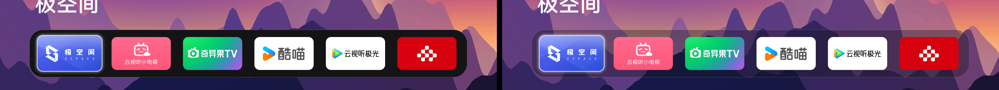
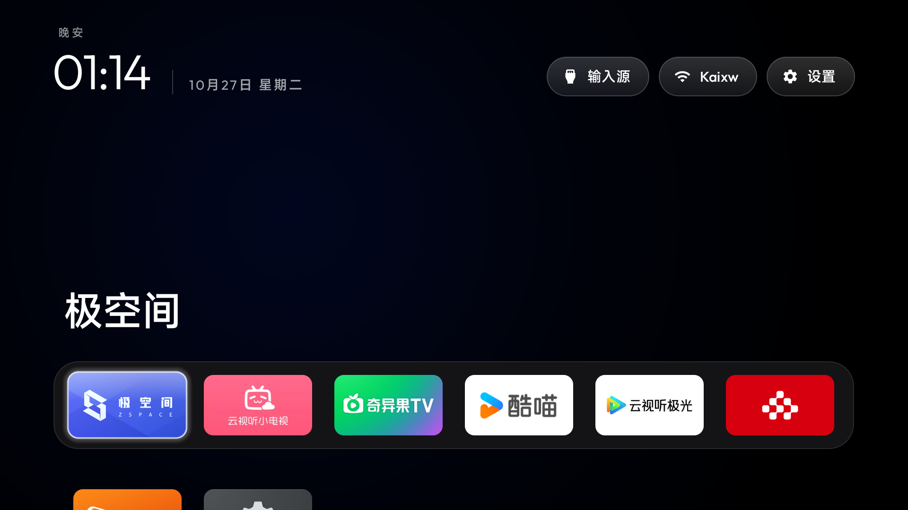
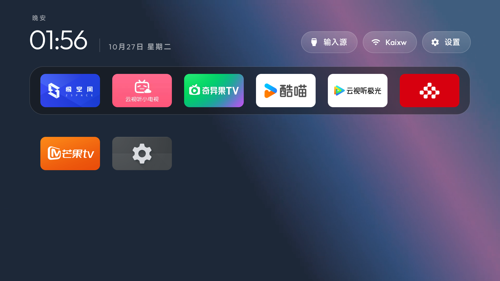
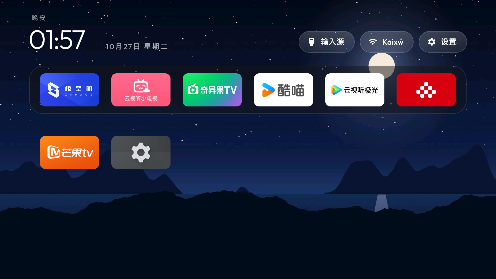
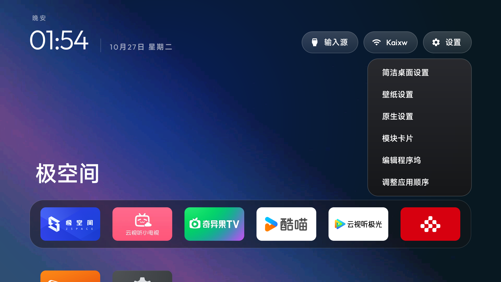
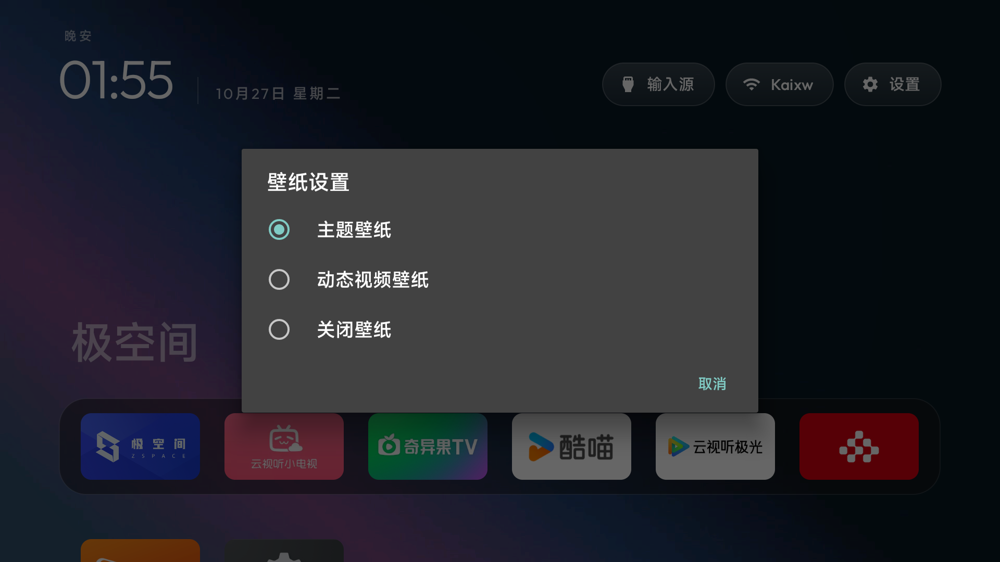
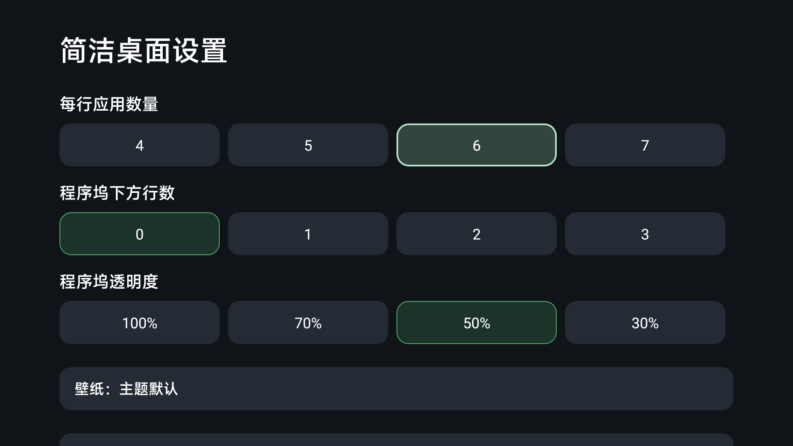

## cleanyourtv-plus（本仓库说明）

本仓库是 [CleanYourTV（Gathin23/cleanyourtv）](https://github.com/Gathin23/cleanyourtv) 的定制分支，面向中国区电视（小米澎湃 OS / 索尼 BRAVIA 国行）做了开箱即用的改造，其余源码、文档与工具保持上游原样。

### 效果对比



左侧为默认程序坞（黑色实底），右侧为本仓库定制后的半透明程序坞（透明度可在电视端 100 / 70 / 50 / 30 四档调整，默认 50%），图标浮在壁纸之上。



小米澎湃 OS 强制禁止第三方应用设为默认桌面，本仓库通过无障碍服务实现「按 Home 键直达极简桌面」，实测可用（配置方法见下文「小米澎湃 OS 配置」）。

### 本仓库相对原版的改动

1. **默认每行 6 个应用**（原版默认 4 个，电视端可在 4–7 之间调整）。修改 `launcher/app/src/main/res/values/config.xml` 中的 `columns`。
2. **程序坞改为 6 个中国区常用应用**（原版为 Netflix / Amazon / YouTube / Hotstar，国行电视基本未安装这些应用，槽位会被网格应用自动填充）：

   | 顺序 | 应用 | 包名 |
   |---|---|---|
   | 1 | 极空间 | `com.zentraedi.zspace.tv` |
   | 2 | NewTV极光（腾讯视频 TV 版） | `com.ktcp.tvvideo` |
   | 3 | 云视听小电视（Bilibili TV 版） | `com.xiaodianshi.tv.yst` |
   | 4 | 奇异果TV（爱奇艺 TV 版） | `com.gitvdemo.video` |
   | 5 | 酷喵（优酷 TV 版） | `com.cibn.tv` |
   | 6 | 生活空间装饰（索尼国行预装 Living Decor） | `com.sony.dtv.livingfit` |

3. **动态壁纸（新增）**：电视端「长按设置 → 壁纸设置」可三选一：
   - **主题壁纸**：跟随主题，支持**时段自动切换**——`themes/scenes` 的 14 张风景按日出/日落分成 morning / evening / night 三组，白天显示白昼景、夜间自动切夜景；
   - **动态视频壁纸**：主题配置 `wallpaper_video` 指向的 mp4 循环播放（参考 skippy-tv 的视频壁纸思路，用 VideoView 静音循环）。仓库自带 `themes/aurora-live`（10 秒 1080p 极光渐变循环，347KB）；想换自己的视频，把任意 mp4（≤300MB）命名为 `wallpapers/wallpaper.mp4` 放进主题目录即可；
   - **关闭壁纸**。

   　

4. **程序坞半透明**：Dock 背景改为可调半透明（`dock_opacity`，默认 50%），并保留聚焦边框；电视端在「简洁桌面设置 → 程序坞透明度」调整。
5. **新增 `SONY-CONFIG.md`**：记录索尼 XR-65X90K（BRAVIA VH21，国行）实机验证的完整配置——每行 6 个、上述程序坞顺序、9 个已禁用的系统组件（遥测/演示/内容推荐）、壁纸设置与恢复方法等，便于其他型号参考或回滚。

### 小米澎湃 OS 配置（Home 键直达）

小米/红米电视（HyperOS）**不允许把第三方应用设为系统默认桌面**：`cmd package set-home-activity` 会返回成功但不生效。本仓库沿用项目自带的 `HomeKeyService` 无障碍服务方案——按 Home 键时把按键事件转交给极简桌面，效果等同「Home 键直达」。

1. 电视开启「设置 → 账号与安全 → ADB 调试」，电脑与本机同网段，`adb connect <电视IP>:5555`（可用仓库 `tools/tv.py`，无需 adb 二进制）。
2. 安装桌面并开启无障碍（Home 键映射）：

   ```bash
   adb shell pm install -r app-release.apk
   adb shell settings put secure enabled_accessibility_services com.gathin.tvhome/.HomeKeyService
   adb shell settings put secure accessibility_enabled 1
   ```

3. 推送主题（可选，自动重启桌面并恢复无障碍服务）：

   ```bash
   TV_HOST=<电视IP> tools/theme.sh themes/scenes        # 时段壁纸主题
   TV_HOST=<电视IP> tools/theme.sh themes/aurora-live    # 视频动态壁纸主题
   TV_HOST=<电视IP> tools/theme.sh --reset               # 恢复内置默认配置
   ```

> 已实测机型：MiTV-MFTR0（小米电视 6，HyperOS 3.0.101.0，Android 14）。恢复系统默认桌面：`adb shell settings put secure enabled_accessibility_services ''` 并在系统设置里关闭该无障碍服务即可。

### 菜单与设置



长按右上角「设置」弹出快捷菜单：**简洁桌面设置 / 壁纸设置 / 原生设置 / 模块卡片 / 编辑程序坞 / 调整应用顺序**。

　

### 索尼 BRAVIA 国行配置

见 [`SONY-CONFIG.md`](SONY-CONFIG.md)：主页接管（`set-home-activity` 直达）、程序坞顺序、去广告组件禁用清单与恢复方法。

---

> 提示：程序坞中未安装的应用会被自动跳过，空槽位由网格应用填充（`fill_dock`），不会留空；换到其他电视型号也能正常显示。

> 与原版的差异为配置文件 + 少量功能改动 + 说明文档，可随时 `git fetch upstream && git merge upstream/main` 跟进上游更新。
