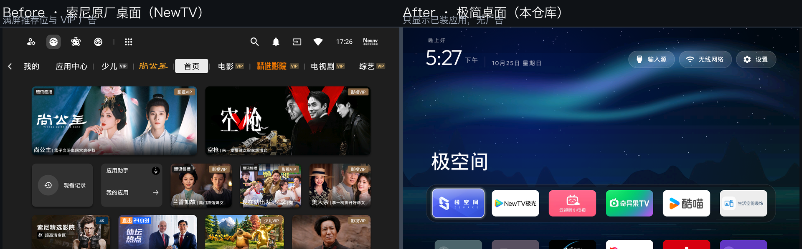

## cleanyourtv-plus（本仓库说明）

本仓库是 [CleanYourTV（Gathin23/cleanyourtv）](https://github.com/Gathin23/cleanyourtv) 的定制分支，在**原始内容基础上仅修改了默认配置**，目标是让中国区电视（尤其索尼 BRAVIA 国行）克隆后即可开箱即用，其余源码、文档与工具保持上游原样。

### 效果对比

左侧为索尼原厂桌面（NewTV 中国互联网电视）：满屏推荐位、VIP 广告与内容分发；右侧为本仓库安装后的极简桌面：只显示你实际安装的应用，无任何广告位。

### 本仓库相对原版的改动

1. **默认每行 6 个应用**（原版默认 4 个）。修改 `launcher/app/src/main/res/values/config.xml` 中的 `columns`。
2. **程序坞改为 6 个中国区常用应用**（原版为 Netflix / Amazon / YouTube / Hotstar，国行电视基本未安装这些应用，槽位会被网格应用自动填充）：

   | 顺序 | 应用 | 包名 |
   |---|---|---|
   | 1 | 极空间 | `com.zentraedi.zspace.tv` |
   | 2 | NewTV极光（腾讯视频 TV 版） | `com.ktcp.tvvideo` |
   | 3 | 云视听小电视（Bilibili TV 版） | `com.xiaodianshi.tv.yst` |
   | 4 | 奇异果TV（爱奇艺 TV 版） | `com.gitvdemo.video` |
   | 5 | 酷喵（优酷 TV 版） | `com.cibn.tv` |
   | 6 | 生活空间装饰（索尼国行预装 Living Decor） | `com.sony.dtv.livingfit` |

3. **新增 `SONY-CONFIG.md`**：记录索尼 XR-65X90K（BRAVIA VH21，国行）实机验证的完整配置——每行 6 个、上述程序坞顺序、9 个已禁用的系统组件（遥测/演示/内容推荐）、壁纸设置与恢复方法等，便于其他型号参考或回滚。
4. **壁纸主题**：建议配合仓库自带 `themes/scenes`（14 张暗色风景、每小时轮播）使用，推主题后在电视端「长按设置 → 简洁桌面设置 → 壁纸」即可直接切换，无需电脑。

> 提示：程序坞中未安装的应用会被自动跳过，空槽位由网格应用填充（`fill_dock`），不会留空；换到其他电视型号也能正常显示。

> 与原版的差异仅此一处配置文件 + 一份说明文档，可随时 `git fetch upstream && git merge upstream/main` 跟进上游更新。
